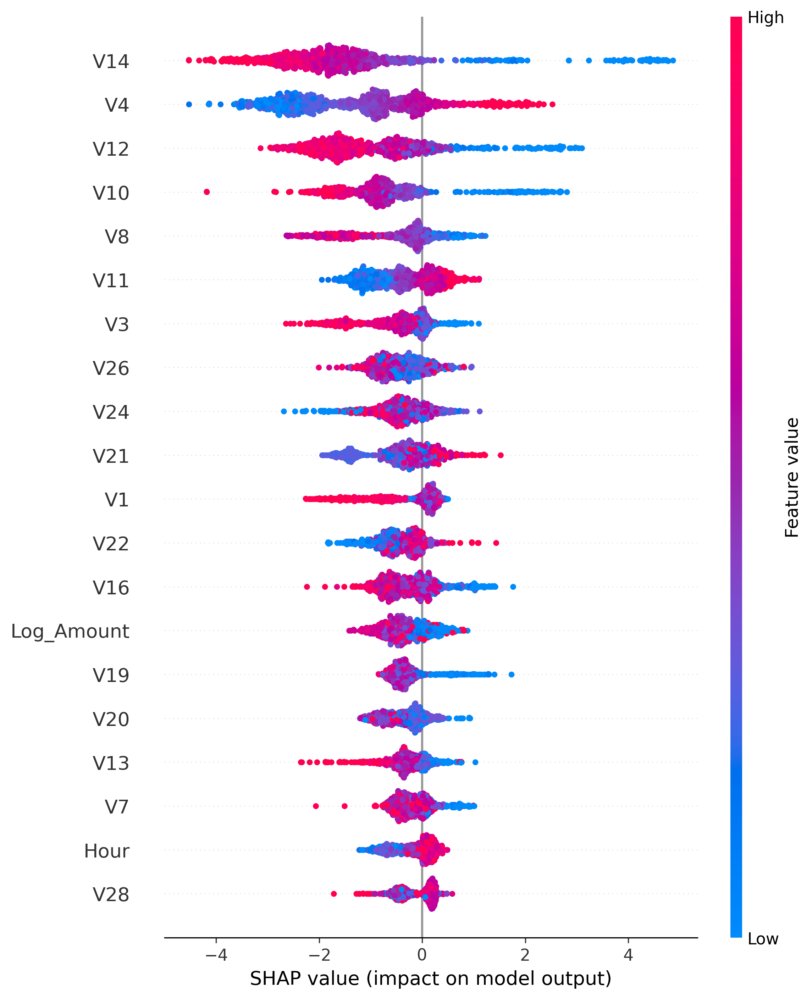
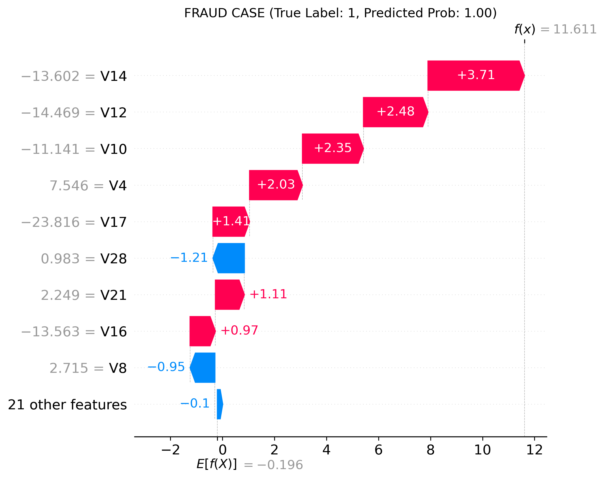
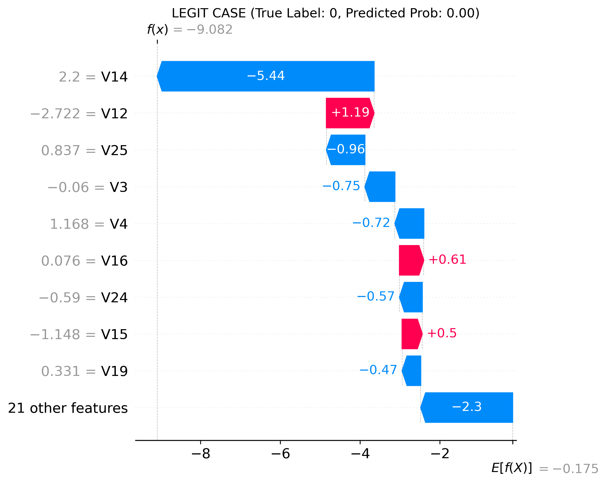

# 🛡️ FraudGuard: credit card fraud detection with explainable AI

   

A fraud detector that does not just say **"block"**. It also explains **why**.
End-to-end pipeline: EDA → baseline → XGBoost → threshold tuning → SHAP explanations → Streamlit app.

**🎬 Demo:** [`Demo.mp4`](Demo.mp4) (47 seconds)

---

## Result in one glance

On an untouched test set of **56,746 transactions (95 real frauds)**:

| | Value |
|---|---|
| Frauds caught | **73 of 95** (recall 76.8%) |
| False alarms | **3** out of 56,651 legit transactions |
| Precision | **96.1%** (73 of 76 alerts are real fraud) |
| PR-AUC | **0.814** (LogReg baseline: 0.681) |

Accuracy is 99.96%, but it means almost nothing here (see [Why not accuracy](#why-these-decisions)).

---

## Problem

Fraud is rare (**0.17%** of transactions) and expensive. Two things make it hard:

1. **Extreme imbalance.** A model that always says "legit" is 99.83% accurate and catches zero fraud.
2. **Trust.** An analyst will not act on a black-box score. Each decision needs a reason.

## Data

[Kaggle: Credit Card Fraud Detection (ULB)](https://www.kaggle.com/datasets/mlg-ulb/creditcardfraud): European cardholders, 284,807 transactions, 31 columns.

- `V1`–`V28`: PCA components (anonymized by the bank, so they have no business names)
- `Time`: seconds since the first transaction · `Amount` · `Class` (1 = fraud)
- No missing values (checked, this is a deliberate observation, not an oversight)
- **1,081 exact duplicates** found and removed *before* the split → 283,726 rows, 473 frauds

Download `creditcard.csv` from Kaggle and put it in `data/creditcard.csv` (the file is not stored in this repo).

## Pipeline

```
creditcard.csv
  → EDA + dedup + features (Hour, log1p Amount)
  → stratified 80/20 split (train / test)
  → train split → 80/20 again (fit / validation)
  → LogReg baseline  →  XGBoost (scale_pos_weight, early stopping on validation)
  → threshold chosen on VALIDATION (PR curve)
  → ONE final evaluation on test
  → SHAP (global + 2 local cases)  →  Streamlit app
```

## Results

### Model comparison (test set, default threshold 0.5)

| Model | PR-AUC | ROC-AUC | Precision (fraud) | Recall (fraud) |
|---|---|---|---|---|
| Logistic Regression (`class_weight='balanced'`) | 0.681 | 0.962 | 0.05 | 0.87 |
| XGBoost (`scale_pos_weight`) | **0.814** | 0.954 | 0.95 | 0.77 |

LogReg catches many frauds only by flagging a flood of legit transactions (precision 5%). Interestingly its ROC-AUC is slightly *higher* than XGBoost's. ROC-AUC is dominated by the huge legit class and hides this problem, which is why **PR-AUC** is the main metric here.

### Threshold tuning (chosen on validation, not on test)

| Target recall (val) | Threshold | Precision (val) |
|---|---|---|
| ≥ 0.80 | 0.9928 | 0.984 |
| **≥ 0.85 (chosen)** | **0.697** | **0.970** |
| ≥ 0.90 | 0.0016 | 0.100 |

Going from 85% to 90% recall collapses precision from 97% to 10%: the last frauds get scores close to zero, so catching them costs an avalanche of false alarms. That is why the target is 0.85.

### Final test result at threshold 0.697

```
              precision    recall  f1-score   support
           0      1.000     1.000     1.000     56651
           1      0.961     0.768     0.854        95

[[56648     3]      TN  FP
 [   22    73]]     FN  TP
```

## Explainability (SHAP)

`shap.TreeExplainer` on a sample of 1,000 test rows (50 frauds + 950 legit), not on all 56k rows: it is enough to see stable patterns and keeps the notebook fast.

| Global importance | Fraud case | Legit case |
|---|---|---|
|  |  |  |

Reading a waterfall: it starts from the average model output and shows how each feature pushes the decision toward fraud or toward legit. Values are in log-odds, the native SHAP unit for XGBoost.

## Streamlit app

Pick a real transaction (or build a what-if scenario) → get a verdict (**BLOCK / APPROVE**), the fraud score, a plain-language explanation of the top factors, the full SHAP waterfall, and model quality metrics in business language.


## Run it

```bash
git clone https://github.com/Zh09-hak/Fraud_Detection.git
cd Fraud_Detection
pip install -r requirements.txt
streamlit run app.py
```

The trained model, the threshold and the test split are stored in `artifacts/`, so the app runs without retraining.

To reproduce everything from scratch: put `creditcard.csv` into `data/`, then run the notebooks in order: **`EDA.ipynb` → `model.ipynb` → `SHAP.ipynb`**.

## Repo structure

```
├── EDA.ipynb          # inspection, duplicates, features, split
├── model.ipynb        # LogReg baseline, XGBoost, threshold tuning, save model
├── SHAP.ipynb         # global importance + 2 local explanations
├── app.py             # Streamlit demo
├── artifacts/         # trained model, threshold, data splits
├── plots/             # EDA and SHAP figures
├── app_screenshots/   # app screenshots
├── Demo.mp4           # 30-second demo
└── requirements.txt
```

## Why these decisions

- **Why not accuracy?** At 0.17% fraud, "always legit" scores 99.83% and catches nothing. I use PR-AUC, precision and recall.
- **Why recall over precision?** A missed fraud costs the full transaction; a false alarm costs a review or a short block. The threshold moves this trade-off, and I picked it explicitly on validation data.
- **`scale_pos_weight` vs SMOTE.** Class weights change the loss and keep the real data distribution; SMOTE invents synthetic points in a PCA space I cannot interpret.
- **Why XGBoost over LogReg?** Fraud patterns are non-linear and interact across features; trees capture that, and PR-AUC improves from 0.68 to 0.81.
- **Why TreeExplainer?** It computes exact SHAP values for tree models efficiently, unlike model-agnostic KernelExplainer.
- **Why drop duplicates before the split?** Otherwise copies of the same transaction land in both train and test and inflate the metrics.
- **No leakage.** Features (`Hour`, `log1p(Amount)`) are row-wise and fit nothing on the data; the threshold is chosen on validation; test is evaluated once and never used for decisions.

## Limitations (honest ones)

- **Small test set.** Only 95 frauds: one transaction moves recall by ~1 point, so PR-AUC and recall carry noticeable uncertainty. Validation recall (85.5%) vs test recall (76.8%) is within that noise.
- **Small validation set** (~75 frauds), used both for early stopping and for the threshold.
- **Random split, not time-based.** A real system should train on the past and test on the future.
- **Scores are not calibrated probabilities**, because `scale_pos_weight` shifts them. The app calls the output a *fraud score*.
- **Anonymized features.** SHAP can say "V14 matters", not "foreign merchant". With real features the explanations would carry business meaning.
- `Hour` is *relative* to the start of the dataset, not a real clock time.
- Two days of European transactions from 2013: fine for a demo, not a production claim.

## Next steps

Time-based validation · probability calibration · cost-sensitive threshold (real cost of fraud vs review) · monitoring for drift.
